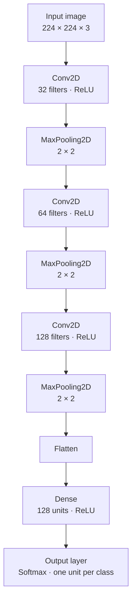
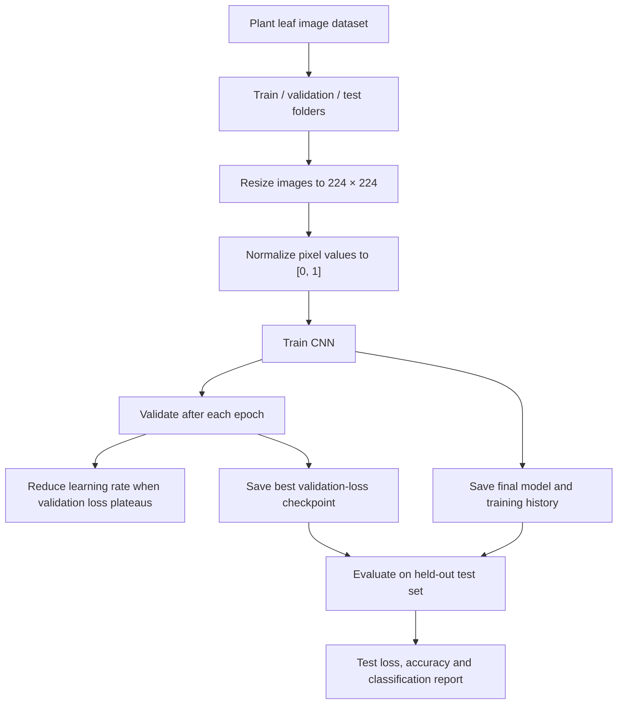

# Plant Disease Classification using CNN

A TensorFlow/Keras image-classification project that learns to classify plant leaf images into disease categories using a custom Convolutional Neural Network (CNN).

## Overview

This project uses a straightforward CNN architecture with three convolutional blocks to classify plant-leaf images. Images are resized to `224 × 224`, normalized to the `[0, 1]` range, and loaded from class-specific folders.

### Model architecture

| Layer | Configuration |
|---|---|
| Input | 224 × 224 × 3 RGB |
| Convolution | 32 filters, 3 × 3, ReLU |
| Max pooling | 2 × 2 |
| Convolution | 64 filters, 3 × 3, ReLU |
| Max pooling | 2 × 2 |
| Convolution | 128 filters, 3 × 3, ReLU |
| Max pooling | 2 × 2 |
| Flatten | — |
| Dense | 128 units, ReLU |
| Output | One softmax unit per class |

**Training configuration:** Adam optimizer, categorical cross-entropy, batch size 32, 10 epochs by default, and `ReduceLROnPlateau` on validation loss.

## Repository structure

```text
plant-disease-classification/
├── data/
│   ├── train/
│   │   ├── class_1/
│   │   └── class_2/
│   ├── valid/
│   │   ├── class_1/
│   │   └── class_2/
│   └── test/
│       ├── class_1/
│       └── class_2/
├── models/                  # Saved model output (not committed)
├── reports/                 # Evaluation output (not committed)
├── src/
│   ├── __init__.py
│   ├── data.py
│   ├── model.py
│   ├── train.py
│   └── evaluate.py
├── .gitignore
├── requirements.txt
└── README.md
```

## Dataset format

Place the dataset under `data/` and organize it into `train`, `valid`, and `test` directories. Each split must contain one subdirectory per class.

```text
data/
├── train/
│   ├── Apple___healthy/
│   ├── Apple___scab/
│   └── ...
├── valid/
│   ├── Apple___healthy/
│   ├── Apple___scab/
│   └── ...
└── test/
    ├── Apple___healthy/
    ├── Apple___scab/
    └── ...
```

The class-folder names should be consistent across all three splits. The dataset itself is not included in this repository.

## Setup

Python 3.9–3.11 is recommended.

```bash
git clone https://github.com/<YOUR_USERNAME>/plant-disease-classification.git
cd plant-disease-classification

python -m venv .venv
```

Activate the environment:

**Windows PowerShell**
```powershell
.venv\Scripts\Activate.ps1
```

**macOS / Linux**
```bash
source .venv/bin/activate
```

Install dependencies:

```bash
pip install -r requirements.txt
```

## Train

From the repository root:

```bash
python -m src.train --data-dir data --epochs 10 --batch-size 32
```

Optional arguments:

```bash
python -m src.train --help
```

The best validation-loss checkpoint and final model are saved under `models/`. Training history is saved to `reports/training_history.json`.

## Evaluate

After training:

```bash
python -m src.evaluate --model models/plant_disease_cnn.keras --test-dir data/test
```

Evaluation reports test loss and accuracy, and prints a classification report and confusion matrix when scikit-learn is available.


## Visualizations

### CNN architecture

The baseline network processes a `224 × 224 × 3` leaf image through three convolutional feature-extraction blocks, followed by a dense classifier.



### Training and evaluation workflow



### Add real training plots

After a training run, use the values in `reports/training_history.json` to create and commit accuracy/loss plots. The repository does not include fabricated charts or performance numbers; the plots should be generated from your own experiment.

Recommended plot files:

```text
reports/
├── training_history.json
├── accuracy_curve.png
├── loss_curve.png
├── confusion_matrix.png
└── class_indices.json
```

You can display generated plots in this README with:

```markdown


```

## Important notes

- The uploaded source code defined a test directory but did not use it for evaluation. This repository adds a separate test-evaluation script.
- The original code used no image augmentation; this implementation also keeps preprocessing to rescaling only.
- The original source specified an initial learning-rate variable of `0.01`, but did not pass it to the optimizer. This implementation uses the Keras Adam default learning rate unless changed in `src/model.py`.
- No accuracy result is claimed here. Run the training and evaluation scripts on your dataset to obtain reproducible metrics.
- The model is a baseline CNN. Performance depends on dataset quality, class balance, and the train/validation/test split.

## Reproducibility

Keep the same dataset split and class-folder names when comparing runs. Record the dataset source, number of images per class, hardware, TensorFlow version, and evaluation metrics when reporting results.

## Future improvements

- Add data augmentation and class-imbalance handling.
- Compare the baseline CNN with transfer-learning models such as MobileNetV2 or EfficientNet.
- Add prediction examples and training curves.
- Add experiment tracking and automated tests.

## License

Choose a license before making the repository public. For example, add an MIT `LICENSE` file only if you intend to distribute the project under those terms.
