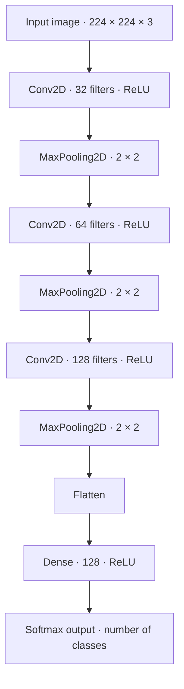
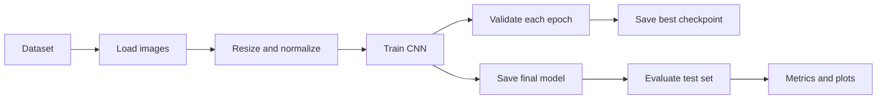

<div align="center">

# 🌿 Plant Disease Classification CNN

### Deep learning for plant leaf disease recognition

**Computer Vision · Deep Learning · TensorFlow · Keras · Python**


*A CNN baseline that classifies plant leaf images into disease categories.*

</div>

---

## 🌱 Overview

This project uses a Convolutional Neural Network (CNN) built with TensorFlow/Keras to classify plant leaf images. Images are resized to **224 × 224 RGB**, normalized to the **[0, 1]** range, and loaded from class-specific folders.

> **Banner:** This README header is created with Markdown, badges, and text. It does not require a separate cover-image file.

## ✨ Features

- 🖼️ Image preprocessing and normalization
- 🧠 Three-block CNN architecture
- 🎯 Multi-class prediction using softmax
- 📉 Validation-loss monitoring with `ReduceLROnPlateau`
- 💾 Best-checkpoint and final-model saving
- 📊 Training curves and test confusion matrix
- 🧪 Separate held-out test evaluation

## 🧩 Model architecture



## ⚙️ Default training configuration

| Parameter | Value |
|---|---:|
| Input size | `224 × 224 × 3` |
| Batch size | `32` |
| Epochs | `10` |
| Optimizer | Adam |
| Loss | Categorical cross-entropy |
| Metric | Accuracy |
| Learning-rate scheduler | ReduceLROnPlateau |
| Minimum learning rate | `1e-6` |

The implementation uses the Keras Adam default learning rate. The original script declared `initial_learning_rate = 0.01` but did not pass it to the optimizer.

## 🔄 Workflow



## 📁 Repository structure

```text
plant-disease-classification-cnn/
├── data/                  # Local dataset (not committed)
│   ├── train/
│   ├── valid/
│   └── test/
├── models/                # Saved models (not committed)
├── reports/               # Metrics and plots (not committed)
├── src/
│   ├── __init__.py
│   ├── data.py             # Dataset loading
│   ├── model.py            # CNN architecture
│   ├── train.py            # Training pipeline
│   ├── evaluate.py         # Test evaluation + confusion matrix
│   └── visualize.py        # Training curves
├── .gitignore
├── requirements.txt
└── README.md
```

## 🗂️ Dataset layout

Create the following structure. Each split should contain one folder per class, with matching class-folder names across all splits.

```text
data/
├── train/
│   ├── Tomato___healthy/
│   ├── Tomato___Early_blight/
│   └── ...
├── valid/
│   ├── Tomato___healthy/
│   ├── Tomato___Early_blight/
│   └── ...
└── test/
    ├── Tomato___healthy/
    ├── Tomato___Early_blight/
    └── ...
```

The dataset is not included. Check the dataset's terms before redistributing any images.

## 🚀 Getting started

### 1. Clone

```bash
git clone https://github.com/<YOUR_USERNAME>/plant-disease-classification-cnn.git
cd plant-disease-classification-cnn
```

### 2. Create a virtual environment

**Windows PowerShell**
```powershell
python -m venv .venv
.venv\Scripts\Activate.ps1
```

**macOS / Linux**
```bash
python -m venv .venv
source .venv/bin/activate
```

### 3. Install dependencies

```bash
pip install -r requirements.txt
```

### 4. Train

```bash
python -m src.train --data-dir data --epochs 10 --batch-size 32
```

Training outputs include:

- `models/best_plant_disease_cnn.keras`
- `models/plant_disease_cnn.keras`
- `reports/training_history.json`
- `reports/class_indices.json`

### 5. Generate training visualizations

```bash
python -m src.visualize
```

This creates `reports/training_curves.png`, containing training/validation accuracy and loss.

### 6. Evaluate on the test set

```bash
python -m src.evaluate --model models/best_plant_disease_cnn.keras --test-dir data/test
```

This prints test loss, accuracy, and a classification report, and saves `reports/confusion_matrix.png` (requires scikit-learn and matplotlib).

## 📊 Results and visualizations

Run training, visualization, and evaluation first. Then commit the generated PNG files to GitHub to display them below.

### 📈 Training curves


### 🧮 Confusion matrix


*These plots are generated from your actual run; no performance numbers are assumed or fabricated.*

## 🧪 Notes and limitations

- The original script defined a test directory but did not evaluate it; this repository adds a separate evaluation script.
- Preprocessing remains rescaling-only to preserve the original baseline. No image augmentation is applied.
- No accuracy claim is made. Actual performance depends on dataset quality, class balance, and split design.
- Keep data splits fixed when comparing experiments and record dataset provenance and software versions.

## 🚀 Future improvements

- Add data augmentation and class-imbalance handling.
- Compare the baseline CNN with MobileNetV2 and EfficientNet transfer learning.
- Add example predictions with confidence scores.
- Add experiment tracking, unit tests, and continuous integration.

## 👨‍💻 Author

**Rahul Sinha**

AI/ML Engineer · Deep Learning · Computer Vision

- GitHub: [Rahul-DSAI](https://github.com/Rahul-DSAI)
- LinkedIn: [Rahul Sinha](https://www.linkedin.com/in/rahul-sinha99/)

## 📄 License

No license has been selected yet. Add a `LICENSE` file before presenting this repository as open source. Ensure the chosen license is compatible with the dataset and dependencies.
